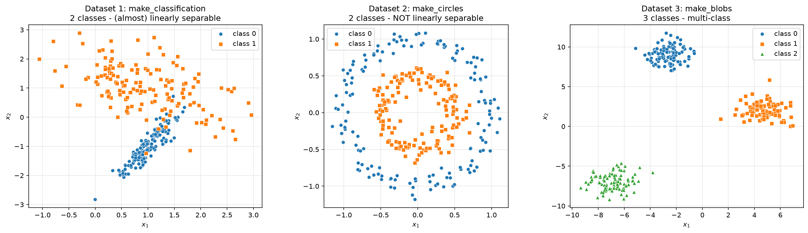
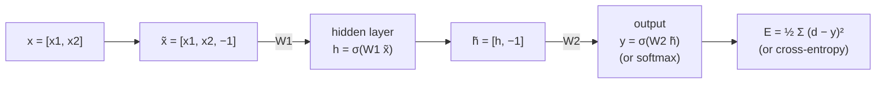
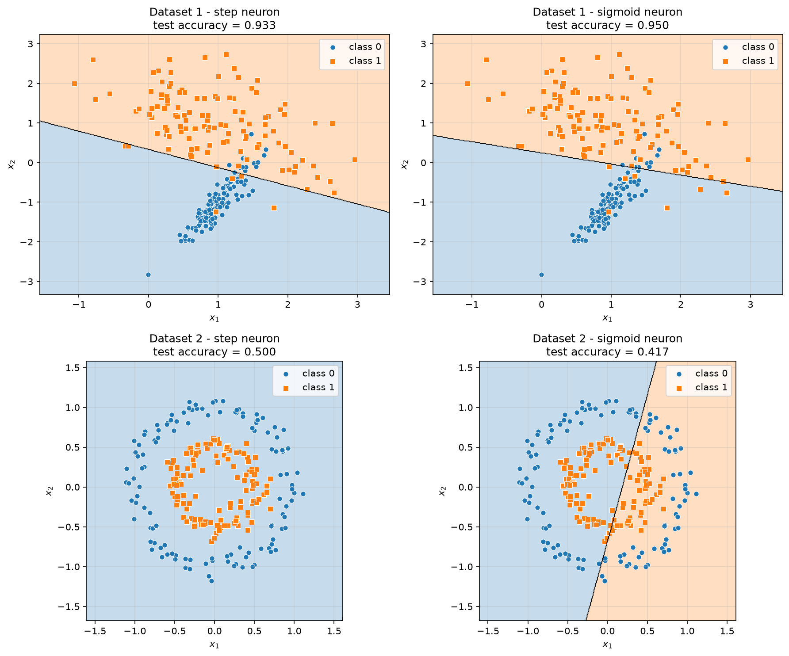
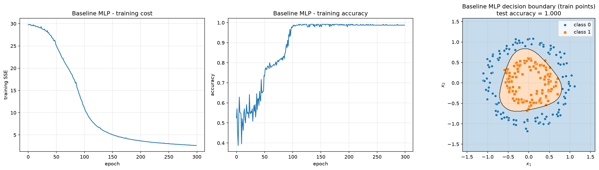
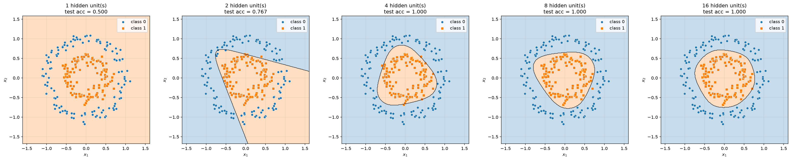
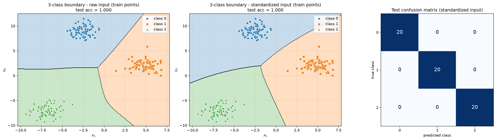
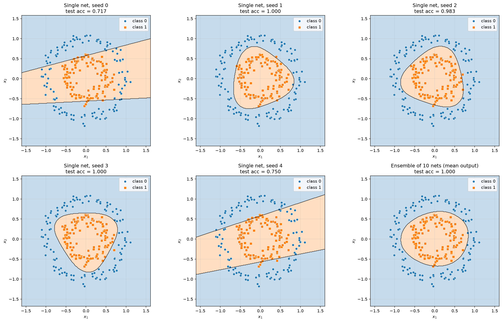

# MLP from Scratch with NumPy

A single neuron and a one-hidden-layer **Multi-Layer Perceptron** written from scratch in pure NumPy: feedforward, backpropagation and weight updates are all hand-written, with no deep-learning framework. The models are tested on three 2-D synthetic datasets, so every decision boundary can be plotted and inspected directly.

> Course project for *Fundamentals of Computational Intelligence*, Amirkabir University of Technology (Tehran Polytechnic), Computer Engineering Department.



## Highlights

- **From scratch:** NumPy does all the model math. scikit-learn is used only to generate data, split it and compute metrics.
- **Verified backprop:** checked against a hand-solved step and against numerical gradients (relative error ≈ 1e-11).
- **Experiments:** perceptron learning rules, weight initialization, learning rate, hidden-layer size, multi-class output, input standardization, ensembles, AdaBoost and Softmax + Cross-Entropy.
- **Reproducible:** every experiment uses fixed seeds and one fixed stratified 80/20 split.

## Contents

| Stage | Topic | What it does |
|---|---|---|
| 1 | Data | Generates `make_classification`, `make_circles` and `make_blobs` (300 samples each) and makes a stratified 80/20 split |
| 2 | Single neuron | Error-correction rule (step) vs generalized delta rule (sigmoid) on a linear and a non-linear dataset |
| 3 | MLP | One-hidden-layer MLP, a hand-solved backprop step, gradient checking, and a baseline model on the circles dataset |
| 4 | Settings | Effect of weight initialization, learning rate and number of hidden units |
| 5 | Multi-class | 3 output neurons on the blobs dataset, raw vs standardized inputs |
| 6 | Ensemble | 10 networks with different seeds, combined by averaging their outputs |
| Bonus (a) | Boosting | AdaBoost-style sequential training of weak MLPs |
| Bonus (b) | Softmax + CE | Softmax output with cross-entropy loss vs sigmoid + SSE |

## Model



- **Bias:** a constant input of $-1$ is appended to the input vector and to the hidden-layer output.
- **Forward:** $h = \sigma(W_1 \tilde{x})$ and $y = \sigma(W_2 \tilde{h})$.
- **Error signals:** output layer $\delta_o = (d - y)\,y(1-y)$; hidden layer $\delta_h = h(1-h) \odot (W_2^\top \delta_o)$, without the bias column of $W_2$.
- **Update:** $W \mathrel{+}= \eta\,\delta\,\tilde{\text{input}}^\top$.
- **Training:** online (one update per sample), with the samples reshuffled every epoch.
- **Code structure:** separate functions for `init_weights`, `forward`, `backward`, `update`, `cost` and `train_mlp`.

## Results at a glance

### Single neuron (Stage 2)

| Dataset | Rule | Test accuracy |
|---|---|---|
| 1 (almost linear) | Error-correction + step | 0.933 |
| 1 (almost linear) | Generalized delta + sigmoid | 0.950 |
| 2 (circles) | Error-correction + step | 0.500 |
| 2 (circles) | Generalized delta + sigmoid | 0.417 |

A single neuron draws one line, so it cannot separate the circles. This is the same limitation as the XOR problem.



### Backprop verification (Stage 3)

Central-difference gradient check with $\varepsilon = 10^{-5}$:

| Case | Relative error |
|---|---|
| 2-2-1 hand-solved network | 2.5e-11 |
| 2-4-1 on dataset 2 | 2.7e-11 |
| 2-4-3 on dataset 3 | 5.9e-11 |
| 2-4-3 Softmax + CE | 4.3e-11 |

### Baseline MLP on circles (Stage 3)

Settings: 2-4-1 network, $\eta = 0.1$, 300 epochs, weights initialized from $U[-1, 1]$. Test accuracy: **1.000**.



### Effect of settings (Stage 4)

| Experiment | Setting | Test accuracy |
|---|---|---|
| Init | all zeros | 0.500 (all hidden units stay identical) |
| Init | U[−1, 1] (5 seeds) | 1.000 ± 0.000 |
| Init | U[−5, 5] (5 seeds) | 0.997 ± 0.007 |
| Init | U[−10, 10] (5 seeds) | 0.890 ± 0.115 |
| Learning rate | 0.001 / 0.01 / 0.1 / 1 | 0.483 / 0.517 / 1.000 / 1.000 |
| Hidden units | 1 / 2 / 4 / 8 / 16 | 0.500 / 0.767 / 1.000 / 1.000 / 1.000 |



### Multi-class (Stage 5)

On the blobs dataset, test accuracy is **1.000** with both raw and standardized inputs. With raw inputs, about 69% of hidden activations are saturated at initialization; with standardized inputs, none are.



### Ensemble and boosting (Stage 6 and Bonus a)

| Model | Test accuracy |
|---|---|
| 3-hidden MLP, 10 seeds (single networks) | 0.927 ± 0.102 |
| Average ensemble of those 10 networks | **1.000** |
| 2-hidden MLP, 10 seeds (weak learners) | 0.623 ± 0.090 |
| Average ensemble of 10 weak learners | 0.767 |
| AdaBoost with 10 weak learners | **0.983** |



## Repository structure

```
.
├── Project1.ipynb   # the whole project: code, experiments and results
├── figures/         # all plots, exported by the notebook
└── README.md
```

## Getting started

```bash
git clone https://github.com/AmirmahdiGolahmar/MLP_from_scratch.git
cd MLP_from_scratch
pip install numpy matplotlib scikit-learn jupyter
jupyter notebook Project1.ipynb
```

To run every cell headless and regenerate all figures:

```bash
jupyter nbconvert --to notebook --execute --inplace Project1.ipynb
```

## Notes

- The notebook's *Interpretation* cells point to the written course report, which is not part of this repository.
- The datasets come from scikit-learn generators with `random_state=42`. The train/test split also uses `random_state=42` and is the same in every experiment.

## Author

**Amirmahdi Golahmar** ([@AmirmahdiGolahmar](https://github.com/AmirmahdiGolahmar))
